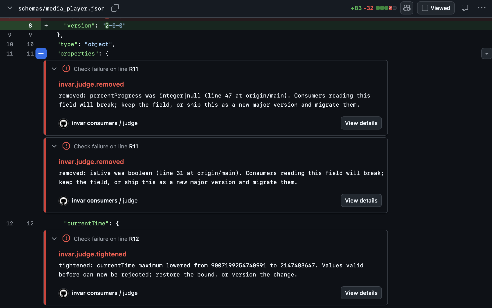

# INVAR

INVAR checks cross-repository contracts: the fields your code reads from
another repository's API. You declare which producer (an OpenAPI/JSON spec or
the producer's source) a consumer file depends on; INVAR compares the
producer's previous and current versions, finds the fields that were removed,
retyped, renamed or re-enveloped, and reports the ones your code actually
reads, with file and line. It is one static binary, local-first, no server,
no account, and it never edits your code.

The honest part is the point: a skip is never a pass. Anything INVAR could
not evaluate (an unsupported language, a read pattern it cannot parse, a
changed default it cannot trace) is stated, with a reason, and the exit code
says so.



*A real break, replayed: Snowplow's media_player 1-0-0 to 2-0-0 change on
[demo PR #3](https://github.com/Ramesh-35/invar-demo-api/pull/3/files).
Each broken promise is annotated on the line where it lives.*

## Sixty seconds

Watch it catch three real breaks first (real incidents, pinned bytes,
measured wall time, run fully offline through the stock engine):

```sh
git clone https://github.com/Ramesh-35/invar && cd invar
cargo run --release -p invar-falsify -- demo
```

No Rust toolchain: download a signed release binary instead (verify it:
[docs/reference/RELEASE-SIGNING.md](docs/reference/RELEASE-SIGNING.md))
and run `invar demo` from the clone. Then, on your own repository:

```sh
invar init          # scans the workspace, proposes invar.toml (a proposal: review it)
invar check         # evaluates the contracts; local files only
invar check --ci    # also fetches remote producers (github:OWNER/REPO@REF:PATH)
```

Zero proposals from `invar init` is the expected result inside a single
repository; INVAR checks contracts BETWEEN repositories, and init says
so and names the next step.

`invar lock` records the exact fields you depend on in `invar.lock`, with
hashes and dates, so future checks compare against what you accepted, and
waivers (capped at 90 days) are explicit and owned. Commit it.

## Exit codes (frozen)

| Code | Meaning |
|---|---|
| 0 | every contract holds |
| 1 | a contract is VIOLATED (a field your code reads changed), and nothing else ever exits 1 |
| 2 | the local evidence ledger failed verification |
| 3 | error, including lock drift for `invar lock`: not a verdict, never silently a pass |
| 4 | something was skipped or not evaluated, stated with reasons |

Exit 4 is non-zero, so a plain `invar check` step fails a CI job by
default; the Action's `fail_on_violation` input gives report-only mode.
Every not-evaluated statement carries a stable reason code
([docs/reference/REASON-CODES.md](docs/reference/REASON-CODES.md)), and
every run ends with the same fixed summary line and the measured record,
even when every count is zero.

## In CI (GitHub Action, hardened)

```yaml
- uses: Ramesh-35/invar@COMMIT_SHA   # pin by SHA; see docs/reference/ACTION-HARDENING.md
  with:
    config: invar.toml
```

Pinned to a release commit, the Action downloads that release's binary and
verifies its checksum and SSH signature before running; pinned to any other
commit, it builds from that exact source; pinned by tag, it warns. Details
and the threat model: [docs/reference/ACTION-HARDENING.md](docs/reference/ACTION-HARDENING.md).

## Evidence receipts

`invar check --receipt r.json` writes a canonical, byte-deterministic record
of the evaluation: every input content-addressed by BLAKE3, the verdict, the
engine version. `invar verify-receipt r.json` re-runs it and must reproduce
the same bytes (exit 0), offline if you have the artifacts
(`--artifacts dir`), with optional SSH signature verification. Receipts from
Linux and macOS are byte-identical, verified in CI for every corpus case.
A receipt proves the evaluation reproduces; it does not prove your code is
correct, and it does not prove the producer is honest.

`invar dependents Type.field --locks dir/` answers "who breaks if I remove
this?" from committed lockfiles. Local directory in, deterministic list out,
no network. `invar check --locks dir/` (or `[dependents] locks = "dir"` in
invar.toml) states, after every check, which sibling lockfiles bind this
repository's producer files; it never changes the exit code.

`invar backtest` replays your locked fields over the producer's own git
history and shows, by commit and date, when each one was absent. It
replays today's extraction over past contents; it is not a replayed
verdict, and it says so in its output.

`invar coverage` states, per contract, what INVAR evaluates here and what
it does not. `invar check --sarif out.sarif` exports results for GitHub
code scanning.

## For AI coding agents

One settings entry makes INVAR part of the agent's edit loop:

```sh
invar hook claude-code --settings   # prints the Claude Code PostToolUse entry; installs nothing
```

After every edit the hook evaluates this repository's contracts; a
VIOLATED contract's witness (contract, field, consumer file and line) is
fed straight back into the agent's context, and nothing else ever is: a
hold, a skip or an error never claims safety and never thrashes the loop.
A directory without invar.toml is silent, so one global entry is safe
everywhere.

`invar mcp` is a read-only MCP server for coding agents (tools: check,
contract, dependents, coverage); it never writes files. Started with
`--lock-signers`/`--lock-principal`, every check and contract result
states whether invar.lock's signature verified in that call
(`lock_state`, `lock_verified`), and a lock that does not verify is an
error, never a verdict. Setup:
[docs/reference/MCP-INTEGRATION.md](docs/reference/MCP-INTEGRATION.md).

## Tell a producer who it breaks, before merge

In a repository that PRODUCES an interface, point INVAR at a directory of
consumers' signed lockfiles:

```sh
invar dependents --locks index/ --repo OWNER/NAME --lock-signers signers
```

Every signed consumer lock naming this repository is evaluated against
the working tree, and each bound field now absent or retyped is named,
per consumer. Unsigned or unverified locks are stated, never read. In the
Action (`dependents_repo`, `dependents_locks`, `dependents_signers`,
`check: 'false'` for pure producers) the report lands as an advisory PR
comment, and on pull requests the index and trust root are read from the
BASE branch, never from the pull request, so a change cannot choose its
own judge. Watch that live: a pull request that deleted the entire index
and trust root in its own diff was still held against main's signed locks
([the attack PR](https://github.com/Ramesh-35/invar-demo-api/pull/2), and
[the honest break](https://github.com/Ramesh-35/invar-demo-api/pull/1)).
A lock records the fields a consumer depends on, not the lines that read
them, and every report says so.

## Judge a declared data contract, at the moment of change

Code is not the only place promises live. A JSON Schema that other teams
read is a declared contract, and `invar judge` holds a change to it
against the version everyone already trusts:

```sh
invar judge --contract schemas/media_player.json --base origin/main
```

The PRE contract is read from the base ref, never from the working tree,
so a change cannot choose its own baseline. A schema is read as a
validation contract: narrowing what it accepts is a break. The verdict
speaks in sentences. On the real Snowplow media_player 1-0-0 to 2-0-0
change (case b1-001 of our pinned corpus), excerpted:

```
VIOLATED: schemas/media_player.json breaks 6 promises made at origin/main.
  tightened: playbackRate maximum lowered from 9007199254740991 to 16.
  Values valid before can now be rejected; restore the bound, or version the change.
    counterexample (valid at origin/main, rejected now): {"currentTime":0,
    "duration":0,"ended":true,"loop":true,"muted":true,"paused":true,
    "playbackRate":16.5,"volume":0}
  removed: percentProgress was integer|null (line 47 at origin/main), from an
  object that admits no other keys. Instances that carry it, valid before, are
  now rejected; keep the field, or version the change.
    counterexample (valid at origin/main, rejected now): {"currentTime":0,
    "duration":0,"ended":true,"loop":true,"muted":true,"paused":true,
    "percentProgress":0,"playbackRate":0,"volume":0}
  ...
  noted: retyped (widened): loop was boolean, is now boolean|null; every value
  valid before is still valid.
judged: property presence and type, enum, numeric, length and item-count
bounds, required, pattern and format, recursively. not judged: $ref, allOf,
anyOf, oneOf, tuple items (stated, never skipped).
```

A break comes with a counterexample whenever INVAR can build one: a whole
instance the base schema accepts and the changed schema rejects. You do not have to trust INVAR to
believe it; save it and run any validator you already use against both
versions. The judge checks each instance itself before printing it, with
a checker for exactly the keywords it reads (from v0.2.9 including
`allOf`, `anyOf`, `oneOf`, `not`, `minProperties`, `maxProperties`,
`uniqueItems`, `dependentRequired` and `multipleOf`); when a schema uses
one it does not read (`pattern`, `format`, `if` and so on), the output
says `no counterexample built:` and names it, rather than print a guess.
On the SchemaStore replay v0.2.9 builds 28 instances for 44 findings on
the 17 commits that break, and every one passes an independent check
with Python `jsonschema`. Checking
the rest by hand the same way showed 3 of the 20 commits we had labelled
breaks are not breaks: no such instance exists
([COUNTEREXAMPLE-SPEC.md](docs/falsification/COUNTEREXAMPLE-SPEC.md)).
From v0.2.8 the three rules behind them are corrected
([JUDGE-R3-SPEC.md](docs/falsification/JUDGE-R3-SPEC.md)), and every
release must pass a gate that reads no hand labels: every counterexample
printed on the whole replay corpus is checked with Python `jsonschema`.

From v0.2.10 a field whose `enum` (or `const`) gains a `type` that every
listed value already has is a stated note, not a break: an enum of
strings that gains `type: string` rejects nothing it accepted before
([JUDGE-D9-SPEC.md](docs/falsification/JUDGE-D9-SPEC.md)). A second
replay runs on Iglu Central (snowplow/iglu-central at 7771e92, 146
consecutive version pairs,
[iglu-replay/replay.py](docs/falsification/iglu-replay/replay.py)).
SchemaVer promises that an ADDITION bump accepts all data the previous
version did. INVAR flags 5 ADDITION bumps, 3 of them with an instance
that Python `jsonschema` confirms, and no printed instance fails that
check.

From v0.2.13 HOLDS means every change was judged
([JUDGE-REACH-SPEC.md](docs/falsification/JUDGE-REACH-SPEC.md)). Until
v0.2.12 it meant only that nothing changed along the paths the judge
walks: auditing AsyncAPI's schemas found a change behind
`patternProperties`, `oneOf` and `$ref` that rejects a whole valid
document, judged HOLDS. Now every change the judge does not check (a
definition reached only through `items` or `anyOf`, a property added to
an open object, an object closed, a `$schema` change) makes the verdict
NOT EVALUATED, naming each schema by its JSON Pointer. On SchemaStore's
history this moves 521 of 594 HOLDS to NOT EVALUATED: those HOLDS were
not earned. In the Action they pass with a warning, never as a silent
pass; no break that was found before is lost.

From v0.2.14 a draft migration (`$schema` from draft-04, -06 or -07 to
another of them, the identifier unchanged) is judged, and stated in a
note, when neither version uses a keyword whose meaning differs between
those drafts ([JUDGE-DRAFT-SPEC.md](docs/falsification/JUDGE-DRAFT-SPEC.md)).

From v0.2.15 an array's element schema is judged like a property, path
`tags[]`, and a break inside it comes with a counterexample in its array
([JUDGE-ITEMS-SPEC.md](docs/falsification/JUDGE-ITEMS-SPEC.md)). On
SchemaStore's history this found breaks no earlier version could see, each
counterexample confirmed by Python jsonschema: cargo.json's new
`crate-type` enum rejects `{"lib":{"crate-type":[""]}}`, and ruff.json's
removal of rule `RUF076` rejects `{"extend-fixable":["RUF076"]}`.

From v0.2.19 a node that spells its type list as the `anyOf` of its types
(`{"type":["string","null"]}` to `{"anyOf":[{"type":"string"},{"type":"null"}]}`,
the common draft-07 migration) is judged equal, with a note naming the
node, when the two spellings are the same in a normal form: each keyword
that applies to one type follows that type, the rest stay shared,
annotations aside ([JUDGE-CANON-SPEC.md](docs/falsification/JUDGE-CANON-SPEC.md)).
Equality only, never inclusion: a branch that also narrows, a shared
keyword moved inside one branch, or `oneOf` in place of `anyOf` stays NOT
EVALUATED. On SchemaStore's history this earns HOLDS for 109 changes that
were NOT EVALUATED, each checked independently in Python, and changes no
VIOLATED or HOLDS verdict.

From v0.2.20 the same normal form reads literals: `{"enum":["x"]}` and
`{"const":"x"}` are one node, a bare `boolean` or `null` type names its
values, a type beside an enum keeps only the values of that type and is
dropped, and an `anyOf` of enums (a `oneOf` of disjoint enums) is their
union ([JUDGE-CANON-R1-SPEC.md](docs/falsification/JUDGE-CANON-R1-SPEC.md)).
A node that differs only in annotations is never a verdict, whatever
construct it carries. On SchemaStore's history this earns HOLDS for 28
more changes (every prettierrc option written `const` among them) and
changes no VIOLATED or HOLDS verdict.

From v0.2.21 `const` is read wherever the judge reads an enum: `const: v`
is `enum: [v]`, so a changed or narrowed `const` is a break with its
counterexample, and a `const` rewritten as the same one-value enum is not
([JUDGE-CONST-SPEC.md](docs/falsification/JUDGE-CONST-SPEC.md)). Before
this, the judge did not read `const` and could call that rewrite a break;
no change in SchemaStore, Iglu or AsyncAPI history triggered it, so a
fixture found it, not a corpus. The enum rule also leaves out values the
base's own `type` never admitted, so losing one is no narrowing.

From v0.2.22 `invar witness BASE HEAD --name NAME --out DIR` writes each
counterexample the judge carries as a SchemaStore test file,
`src/negative_test/NAME/invar-NN-<path>.json` (or `src/test/NAME/` with
`--positive`, for a pull request that restores what the base accepted),
pretty-printed the way SchemaStore's CI expects
([WITNESS-SPEC.md](docs/falsification/WITNESS-SPEC.md)). A finding then
arrives upstream as the file their CI already runs, not as an issue to
act on. On the 15 breaks of SchemaStore's own test documents, it writes 7
files for the 6 the static judge reaches, each confirmed by both
validators; the other 9 are the instance check's, and are not
pretended into documents.

From v0.2.23 a `type` written where a field had none is a break, not a
note: a field with object keywords and no type accepted a string, a
number, null; writing `"type": "object"` rejects them, and the
counterexample says so ([JUDGE-D5-R1-SPEC.md](docs/falsification/JUDGE-D5-R1-SPEC.md)).
Until this release the judge called that "type made explicit" and HOLDS,
on 13 SchemaStore changes and in two of its own frozen fixtures. It was
found by a dataset INVAR did not make: 76 SchemaStore version pairs that
a complete witness-generation algorithm (Attouche et al., ACM TODS 2026,
shipped with Baazizi et al. 2026) proved to break; INVAR said HOLDS on
one. Those 76 pairs are now a release gate (`docs/falsification/wg-bench`),
the first whose labels INVAR did not produce: HOLDS on any of them fails
the release.

From v0.2.24 a `$ref` with sibling keywords under draft-07 or earlier is
stated and not judged ([REF-SIBLINGS-SPEC.md](docs/falsification/REF-SIBLINGS-SPEC.md)).
Those drafts say the siblings are ignored; Python jsonschema ignores them
and Ajv 8 applies them, so a document there is valid in one validator and
invalid in the other, and no verdict can hold for both. One sixth of the
SchemaStore files in INVAR's corpus carry such a node; 70 changes that
were judged are now NOT EVALUATED with the reason `ref_siblings`, 28 of
them former HOLDS, because a HOLDS one validator would contradict is
not one. Under 2019-09 and 2020-12 siblings apply by the specification
and nothing changes.

In the Action, one input:

```yaml
- uses: Ramesh-35/invar@COMMIT_SHA
  with:
    check: 'false'
    judge_contract: schemas/media_player.json
```

HOLDS passes. VIOLATED fails the job and the verdict lands in the step
summary. A brand-new contract passes, stated as `new_contract`: nothing
was promised before. An unparsable contract or an unreadable base ref
fails: a lost baseline is never a pass. `--format json` carries the same
facts for machines, including `unjudged_constraints`, and `--receipt`
writes the canonical record.

A repository with many contracts gives a glob instead. Every matching
contract the change touches is judged in one pass; unchanged ones are
counted, not judged:

```yaml
    judge_contracts: 'schemas/**/*.json'
```

```sh
invar judge --contracts 'schemas/**/*.json' --base origin/main
```

Each file keeps its own verdict and its own annotations. A deleted
contract is NOT EVALUATED (`contract_deleted`) and fails the job:
everything it promised is withdrawn. A glob that matches nothing is an
error, never a pass. The sentences state what changed in the contract and
what that does to validity, never a guess about who reads it.

A repository that keeps example documents beside its contracts can name
them, and every document the base accepted is validated at the head:

```yaml
    judge_contracts: 'src/schemas/json/*.json'
    judge_tests: 'src/test/{name}'
```

A document rejected is a break only when two validators agree, Python
jsonschema and Ajv 8: the file, the pointer and both messages, whatever
the static judge could reach. A document the two validators answer
differently is listed as disputed, never a break and never a pass, and
documents that pass prove nothing: there is no HOLDS from a corpus
([JUDGE-TESTS-SPEC.md](docs/falsification/JUDGE-TESTS-SPEC.md),
[JUDGE-TESTS-R1-SPEC.md](docs/falsification/JUDGE-TESTS-R1-SPEC.md)).
Both validators read the schema's own draft, 04 through 2020-12; a
`$schema` naming none of them is read as draft-07 by both
([JUDGE-TESTS-R2-SPEC.md](docs/falsification/JUDGE-TESTS-R2-SPEC.md),
v0.2.25: before it the Ajv side refused 2019-09 and 2020-12 schemas, and
43 SchemaStore changes were unverifiable for that reason alone). A `$ref`
to another file is read from the contract's own directory, at the base
commit for the base side and the working tree for the head, by the last
segment of the URI; nothing is ever fetched
([JUDGE-TESTS-R3-SPEC.md](docs/falsification/JUDGE-TESTS-R3-SPEC.md),
v0.2.26: 62 more SchemaStore changes became checkable, 8 stay
unverifiable and say why). On
SchemaStore's own test files this finds 15 changes that break a document
of their own, 7 of them beyond the static judge's reach
(`pull-request-labeler`, `ryl`, `github-action` and `global.json` among
them), lists 4 as disputed, and contradicts no HOLDS verdict.

The judged set is stated and narrow, on purpose: property presence and
`type` (a type change that keeps every value valid, such as `boolean` to
`boolean|null`, is a stated note, not a break), enum narrowing, tightened bounds, newly required fields, and
changes to `pattern` or `format` (flagged as changed; whether a regex
change narrows what is accepted is not decided, and the verdict says so),
recursed with dotted-path witnesses. Not judged yet, and printed in every
output: `$ref`, `allOf`, `anyOf`, `oneOf`, `items`. Specs, fixtures and
the mutation record:
[docs/falsification/JUDGE-SPEC.md](docs/falsification/JUDGE-SPEC.md),
[docs/falsification/JUDGE-SUBTYPE-SPEC.md](docs/falsification/JUDGE-SUBTYPE-SPEC.md).
From v0.2.12 the judge also takes two files directly, with no git and
no setup: `invar judge old.json new.json` (the base first, then the
change). The engine, the verdicts and the exit codes are the repository
mode's, by construction
([JUDGE-FILEPAIR-SPEC.md](docs/falsification/JUDGE-FILEPAIR-SPEC.md)).

`invar judge` ships from v0.2.0; the subtype checks (enum, bounds,
required, pattern, format) from v0.2.1; inline PR annotations and
`--format sarif` from v0.2.2.

**Make the check hold at merge time.** INVAR judges the change against
the base as it was when the job ran. If the base moves before the merge,
that verdict is about an older base. GitHub closes that gap for you: in
branch protection, make the judge check required and turn on "Require
branches to be up to date before merging", or use a merge queue. Either
way, nothing merges until the judge has passed against the current base.

**A receipt anyone can check.** `--receipt` records the exact base
commit, a BLAKE3 hash of both contract versions, and the full result.
Sign it with your own key (INVAR never holds one):

```sh
ssh-keygen -Y sign -n invar-receipt -f ~/.ssh/id_ed25519 receipt.json
invar verify-receipt receipt.json --signers allowed_signers --principal you@example.com
```

Run in the repository with the base commit fetched, `verify-receipt`
re-reads both contracts from git and the working tree,
re-judges them, and must reproduce the receipt byte for byte. An edited
verdict fails, even with its footer recomputed. Spec:
[docs/falsification/JUDGE-RECEIPT-SPEC.md](docs/falsification/JUDGE-RECEIPT-SPEC.md).

## What INVAR does not do

No semantic checks: INVAR evaluates structure (a field's presence, type,
name, envelope), never what values mean. No runtime behavior: nothing is
executed. Payload ingestion covers JSON and a stated
TOML subset (YAML and binary payloads are stated as not evaluated,
exit 4). And it misses real breaks:

Measured on a corpus of 122 real cross-repository break cases and controls
(sourced from public incidents, pinned commits, scored on held-out batches
the rules never saw): INVAR currently catches 38 of 70 held-out in-scope
real breaks. That is a 46% miss rate, the detection-reliability hypothesis
is recorded as FALSIFIED against our own 20% gate, and every release note
says so. What INVAR adds even where it misses: what it did not evaluate is
stated instead of silently passed, the lock records exactly what you
accepted and when, and the receipts make every verdict reproducible. The
full, unvarnished record: [docs/epistemic/STATUS.md](docs/epistemic/STATUS.md),
corpus and per-batch scores in [docs/falsification/](docs/falsification/).

What we promise never to break, in writing: [docs/COMPATIBILITY-COVENANT.md](docs/COMPATIBILITY-COVENANT.md).

Unsupported languages (C, C++, C#, PHP, Swift, Java, Kotlin, Ruby) are
SKIPPED, stated, exit 4; never a pass.

## Research harness

This repository also contains the falsification harness that produced the
record above (`invar run`, `validate`, `report`, `verify`, `audit`,
`replay`, the corpus under `corpus-real/`, and the runner in `scripts/`).
It exists to attack INVAR's own claims; batches are sourced after each
rule's spec is frozen and hashed. To add a real case, see the admission
rules in [docs/falsification/R1-CORPUS.md](docs/falsification/R1-CORPUS.md).

## License

Licensed under either of [Apache License 2.0](LICENSE-APACHE) or
[MIT](LICENSE-MIT), at your option. See [`LICENSE`](LICENSE). Corpus
data is separately licensed under
[CDLA-Permissive-2.0](LICENSE-DATA); see
[docs/reference/CORPUS-DATA.md](docs/reference/CORPUS-DATA.md). Files
under `demo/` keep their upstream licenses ([demo/NOTICE](demo/NOTICE)).

<!-- Total Downloads -->
[](https://crates.io/crates/invar-falsify)

<!-- Recent Version Downloads -->
[](https://crates.io/crates/invar-falsify)
